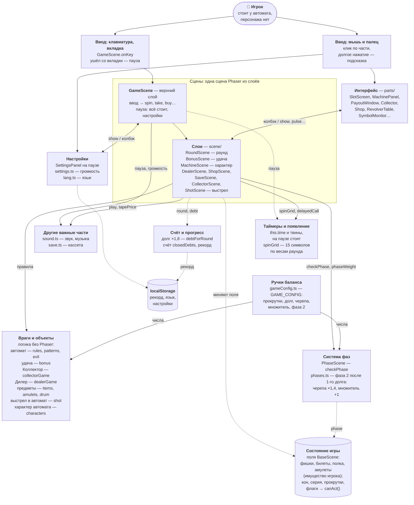
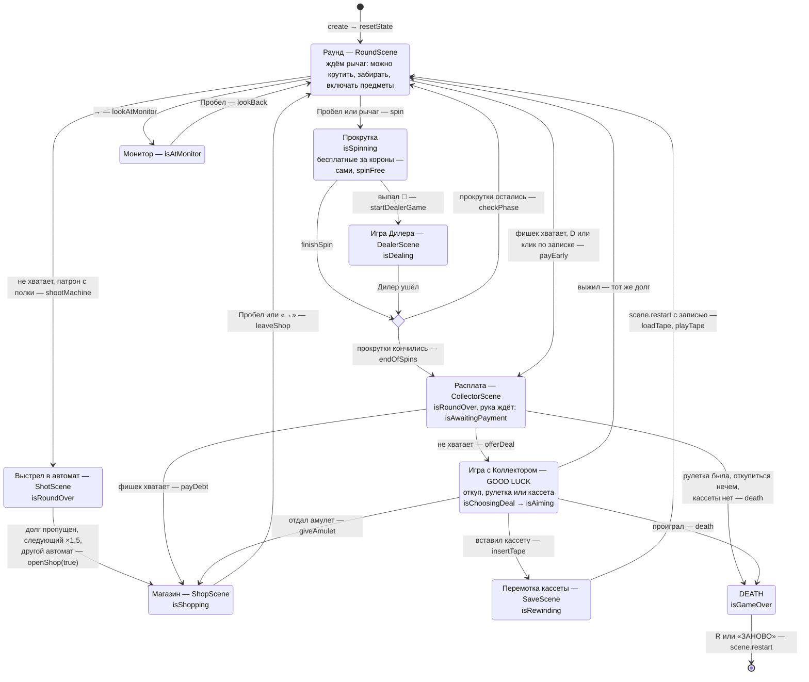
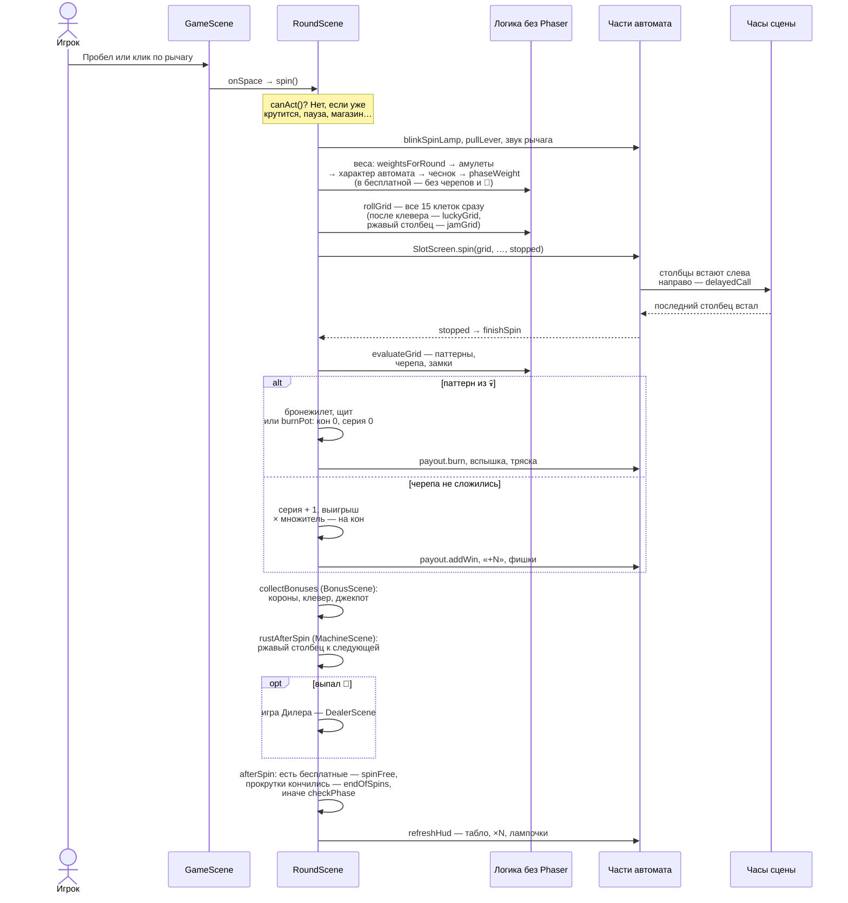

# Архитектура «Долговой ямы»

Схема игры такой, какая она в коде сейчас (ДЗ №2, 20.10.2026). Все имена на схемах — настоящие файлы, классы и методы из `src/game/`.

Как устроено, коротко:

- **одна сцена Phaser** — `GameScene`, собранная из слоёв (`src/game/scene/`): каждый слой добавляет свою часть игры;
- **правила и числа — в файлах без Phaser** (`rules.ts`, `patterns.ts`, `items.ts`…): их проверяет симуляция на тех же файлах, что и игра;
- **картинки и анимации — в частях автомата** (`src/game/parts/`): сцена решает, что происходит, и говорит частям, что показать. Части друг о друге не знают и состояние забега не меняют.

**Стрелки:** сплошная — «вызывает» (метод, функция или колбэк; от ручек баланса — «даёт числа»: их берут `rules.ts` и `phases.ts`), с двумя концами — вызывают друг друга (часть зовёт колбэк сцены, сцена — методы части), пунктирная — «меняет состояние» (поля забега, часы, хранилище браузера).

## 1. Общая схема

Подробнее: какие слои передают ход друг другу — раздел 3, одна прокрутка от клавиши до табло — раздел 4, что в каком слое — раздел 5.

## 2. Пункты задания — где они в игре

| Пункт | Что это в «Долговой яме» | Где в коде |
|---|---|---|
| Сцены | Одна сцена `GameScene`, собранная из 11 слоёв-наследников (раздел 5). Меню нет — игра стартует сразу. | `GameScene.ts`, `scene/*.ts` |
| Игрок | Персонажа нет: вид от первого лица, игрок стоит у автомата. Его «тело» — имущество: фишки на табло, билеты, предметы на полке, амулеты в гнёздах. | поля `balance`, `tickets`, `shelf`, `amulets` в `BaseScene` |
| Враги и объекты | Враги: **Коллектор** (рука за долгом; не хватило — GOOD LUCK на экране автомата и рулетка с револьвером, одна за забег), **Дилер** («больше или меньше»), сам **автомат** — паттерн из 💀 сжигает кон, злые символы 🕷 🔒 🩸; в него можно выстрелить своим патроном из револьвера Коллектора — долг пропущен, следующий ×1,5, приходит другой автомат — с характером: 💰 Жадный, 🍉 Фруктовый, ⭐ Счастливый или 🔩 Ржавый (свои веса символов, выплаты и одно правило). Объекты — данными: 15 символов, 14 паттернов, 4 предмета, 12 амулетов, 8 секторов барабана в магазине; удача — 👑 (3 и больше — бесплатные прокрутки) и 🍀 (следующая прокрутка с паттерном), джекпот даёт ещё билеты и прокрутки. | `CollectorScene` + `collectorGame.ts`, `ShotScene` + `shot.ts`, `MachineScene` + `characters.ts`, `DealerScene` + `dealerGame.ts`, `BonusScene` + `bonus.ts`, `rules.ts`, `patterns.ts`, `evil.ts`, `items.ts`, `amulets.ts`, `drum.ts` |
| Ввод | Клавиатура — в одном месте: `onKey` пропускает автоповтор (а на паузе — всё, кроме «продолжить», звука и языка), `onSpace`, `onEnter`, `onNumber` выбирают действие по состоянию; → и ← — повернуться к монитору символов и обратно (`lookAtMonitor`, `lookBack`). Мышь и палец — клик по части, часть зовёт колбэк сцены; долгое нажатие — подсказка (`attachHint`). Ушёл со вкладки — пауза. | `GameScene.ts`, `parts/tooltip.ts` |
| Состояние игры | Простые поля `BaseScene`: кон, серия, прокрутки, бесплатные прокрутки (`freeSpins`), долг, раунд, какой автомат стоит (`machine`)… и флаги режима (`isSpinning`, `isShopping`, `isDealing`, `isPaused`, `isAtMonitor`…). `canAct()` — можно ли крутить и забирать (пока есть бесплатные прокрутки — нельзя: они крутятся сами). Меняют их только слои сцены, `resetState()` ставит начало забега. | `scene/BaseScene.ts` |
| Счёт и прогресс | Счёт — закрытые долги (`closedDebts`; пропущенный выстрелом в автомат тоже: раунд пройден), рекорд — в `localStorage`. Долг растёт ×1,8 за раунд, по раундам входят новые символы. Рулетка с Коллектором — одна за забег (`roulettes`): второй раз не хватило фишек, а откупиться нечем и кассеты нет, — DEATH. Кассета — один откат за забег: запись в памяти (`tapeRecord`), вставил — забег возвращается к ней. | `rules.ts` (`debtForRound`, `symbolsUnlockedAt`), `BaseScene.updateRecord`, `collectorGame.ts`, `save.ts` |
| Система фаз | Фаза — по прогрессу игрока, числу закрытых долгов. Фаза 2 «автомат злится» — после первого долга: вес черепа ×1,4 и множитель +1 за прокрутку. Меняется только в спокойный момент (начало раунда, между прокрутками). Условие перехода — `phaseAt`, что делает новая фаза — `announcePhase` и данные `PHASES`: сменить условие — одна функция. Новость — «ФАЗА 2» на стекле и знаки 💀▲ ×▲: они улетают под окошко множителя и остаются там (`MachinePanel.flyPhaseSigns`). | `phases.ts`, `scene/PhaseScene.ts` |
| Таймеры и появление | Все таймеры — часы сцены `this.time` и твины, поэтому пауза останавливает их разом. Появление: каждая прокрутка — 15 символов по весам (`spinGrid`; после клевера — `luckyGrid`: случайный паттерн наверняка); новые символы по раундам (и на мониторе); шанс 🎲 растёт, пока его нет; бесплатные прокрутки за короны идут сами — следующая через 0,9 с после итога (`spinFree`); рука Коллектора — через 1,3 с после последней прокрутки; витрины магазина случайные, барабан — сектор из тех, что могут выпасть (`randomSector`). | `rules.ts`, `evil.ts`, `bonus.ts`, `items.ts`, `amulets.ts`, `drum.ts`, `RoundScene.afterSpin`, `RoundScene.endOfSpins`, части |
| Интерфейс | 23 части автомата и комнаты: экран 5×3 (и ржавый столбец), табло, окошко выплаты, рука, магазин с барабаном, полки (до 8 мест), столы Дилера и Коллектора (рулетка, выстрел в автомат), разбитый экран, цвет корпуса и значок автомата, монитор символов, подсказка, экран паузы… Неподвижное рисуется кодом и запекается в текстуры. | `parts/`, `decor.ts`, `layout.ts`, `theme.ts` |
| Настройки | **Ручки баланса** в одном месте — `GAME_CONFIG`: прокрутки в раунде, долг и его рост, вес черепа, множитель, фаза 2. Сделать игру сложнее — поменять числа там: черепа 26 → 34 дают 4,0 долга вместо 7,1 (симуляция). **Настройки игрока** — громкость звуков и музыки (по 5 ступеней), язык: на паузе, запоминаются. | `gameConfig.ts`; `settings.ts`, `lang.ts`, `parts/settingsPanel.ts` |
| Другие части | Звук и музыка — синтез Web Audio: `Sound` создаётся один раз и живёт дольше сцены. Кассета — откат (запись в памяти, не в браузере). Два языка. | `sound.ts`, `save.ts`, `lang.ts` |

## 3. Ход забега — состояние игры

- Флаги — поля `BaseScene`. По ним `canAct()` решает, можно ли крутить, а `onSpace`, `onEnter`, `onNumber` в `GameScene` — что сейчас значит клавиша: Пробел в раунде — рычаг, в магазине — «назад», у Коллектора — рулетка; 9 в магазине — купить кассету, вне магазина — вставить её; ↑ и ↓ у Дилера — «больше» и «меньше», в рулетке — выстрел в Коллектора и в себя.
- **Отдать долг раньше** (`payEarly`) — тот же конец раунда (`endOfSpins`), только прокрутки пропадают раньше, а рука Коллектора сама забирает долг (`callCollector(isPaidEarly)`). Можно ли — `canPayEarly()`: по нему `refreshHud` зажигает записку.
- **Кассета** (`tapeState`: продаётся → куплена → записана → израсходована; `tapeRecord` — что записано) хранит запись в памяти. Уходя из магазина, `SaveScene.leaveShop` записывает начало раунда (`recordTape`). Вставить — `insertTape`, можно, когда `canRewind()` (Коллектор ждёт, а фишек не хватает): плёнка перематывается, и сцена перезапускается с записью — `scene.restart({ tape })`; `create` загружает её до частей (`loadTape`) и начинает раунд после (`playTape`). «Заново» передаёт пустые данные — `restart({})`: без них Phaser отдал бы сцене прошлые, и «заново» снова откатило бы забег.
- **Пауза** (`isPaused`, `GameScene.pauseGame`) — поверх любого состояния, кроме перемотки кассеты и DEATH: Esc, P, ⚙ или ушёл со вкладки. Всё замирает: `tweens.pauseAll()`, `time.paused`, `AudioContext.suspend()`. «▶» — дальше с того же места.
- **Бесплатные прокрутки** (`freeSpins`, слой `BonusScene` их начисляет, `RoundScene.spinFree` крутит) — тоже не отдельное состояние: пока они есть, `canAct()` не пускает игрока, а `afterSpin` сам запускает следующую. Кончились — как обычно: прокрутки остались — раунд, нет — расплата.
- **Барабан** в магазине (`ShopScene.spinDrum` → `winDrum`) — тоже не отдельное состояние: пока колесо крутится, `isShopping` снят — покупать и уходить нельзя; встало — приз летит на полку или на табло, `isShopping` снова поднят.
- **Выстрел в автомат** (`ShotScene.shootMachine`) — патрон включают с полки, как предмет (`RoundScene.useItem`), между прокрутками и только когда фишек вместе с коном не хватает на долг (`canShoot`). Раунд закрывается так же, как в конце прокруток (`closeRound`), только вместо расплаты — выстрел: вид к Коллектору, патрон в его револьвер (`RevolverTable.loadBullet`, `shootMachine`), экран разбит (`BrokenScreen.shatter`). Дальше магазин с долгом ×1,5 (`openShop(true)`, `debtAfterShot`); перед ним `changeMachine` выбирает другой автомат, а в начале следующего раунда он встаёт на место разбитого (`BrokenScreen.repair`, `showNewMachine`). Счёт — `closedDebts = round − 1`, поэтому пропущенный долг считается, как откуп амулетом.
- **Характер автомата** (`machine`, данные — `characters.ts`, слой `MachineScene`) — тоже не отдельное состояние, а набор чисел: веса символов (`characterWeight` в `RoundScene.symbolWeight`), выплаты (`winFactor` в `addToPot`), долг (`characterDebt` в `ShopScene.openShop`; после выстрела — только ×1,5). Ржавый автомат: после прокрутки `rustAfterSpin` может заржавить столбец — его видно заранее, в следующей прокрутке `rollGrid` оставляет в нём прошлые символы (`jamGrid`); раунд кончился — `clearRust`. Кассета записывает автомат (`RunSave.machine`).
- **Монитор** (`isAtMonitor`, `GameScene.lookAtMonitor` / `lookBack`) — вид повёрнут к монитору символов: туда — → или клик по монитору, назад — Пробел, ←, → или клик. `canAct()` не пускает крутить и забирать.
- **Фаза 2** — не отдельное состояние, а смена правил: закрыт первый долг — и в начале следующего раунда (`startRound`) `checkPhase` меняет фазу. Посреди прокрутки правила не меняются. После «заново» `resetState` возвращает фазу 1.

## 4. Одна прокрутка — ввод, таймеры, появление символов

Результат прокрутки известен сразу (`spinGrid`), анимация только показывает его. Пока столбцы встают, `isSpinning` не пускает вторую прокрутку.

## 5. Слои сцены

Каждый слой — наследник предыдущего (`extends`) и видит всё, что ниже. `GameScene` — верхний.

| Слой | Строк | Что добавляет |
|---|---|---|
| `BaseScene` | 279 | состояние забега, поля частей, `resetState`, `refreshHud`, `canAct`, `canPayEarly`, рекорд |
| `PhaseScene` | 34 | `checkPhase` (по закрытым долгам), новость «ФАЗА 2» и знаки фазы |
| `BonusScene` | 67 | удача: `rollGrid` (после клевера — прокрутка с паттерном), `collectBonuses` — короны дают бесплатные прокрутки, клевер — удачу, джекпот — билеты и прокрутки |
| `MachineScene` | 61 | характер автомата: ржавый столбец (`rustAfterSpin` → `rollGrid` оставляет его символы → `clearRust` в конце раунда), смена автомата после выстрела (`changeMachine`) и его приход (`showNewMachine`). Своё состояние (`rustyColumn`, `lastGrid`) — в своих полях |
| `RoundScene` | 452 | прокрутка и бесплатная прокрутка (`spin`, `spinFree` → `roll`), кон, «забрать» (множитель — пополам), «НА ДОЛГ ХВАТАЕТ», предметы, злые символы, начало и конец раунда (`closeRound`), долг раньше (`payEarly`). `callCollector`, `startDealerGame` и `shootMachine` здесь абстрактные — их делают слои выше |
| `DealerScene` | 84 | игра Дилера: угадать карту, остановиться — фишки стопки съезжают на кон |
| `ShopScene` | 250 | магазин: предметы, места полки, амулеты, гнёзда, билет; барабан — `spinDrum` → `winDrum` (приз на полку или табло) |
| `SaveScene` | 133 | кассета — один откат: цена в магазине (`openShop`, `refreshShop`), покупка (`buyTape`), запись на выходе из магазина (`leaveShop` → `recordTape`), вставить (`insertTape` → перезапуск сцены с записью), после перезапуска — `loadTape`, `playTape` |
| `CollectorScene` | 247 | расплата; не хватило — GOOD LUCK, откуп амулетом, рулетка или кассета (ходы по очереди, Коллектор решает по `collectorTarget`), DEATH. Своё состояние рулетки (`cylinder`) — в своих полях, как у Дилера |
| `ShotScene` | 148 | выстрел в автомат: патрон в магазине (`buyBullet`, цена — `openShop`, `refreshShop`), выстрел (`shootMachine` → `aimAtMachine` → `hitMachine` → `changeMachine` и магазин с долгом ×1,5), новый автомат в начале раунда (`startRound` → `showNewMachine`) |
| `GameScene` | 325 | камера, создаёт части, разбирает ввод, пауза, настройки, поворот к монитору символов |

Новый кусок игры — новым слоем: так в ДЗ №2 появился `PhaseScene`, в шаге 29 — `BonusScene`, чтобы не раздувать `RoundScene`, в шаге 32 — `ShotScene`, в шаге 33 — `MachineScene`.

## 6. На чём держится устройство

- Правила и числа — в файлах без Phaser: их проверяет симуляция (20 000 забегов) на тех же файлах, что и игра. Главные числа — ручки `GAME_CONFIG`: код отвечает «как», настройки — «сколько».
- Части показывают, но не решают: состояние забега меняют только слои сцены, клик по части — колбэк в сцену.
- Время — только часы сцены и твины, поэтому пауза — это `tweens.pauseAll()`, `time.paused` и `AudioContext.suspend()`.
- «Заново» — `scene.restart({})`: части создаются заново, состояние ставит `resetState()`. Откат кассетой — тот же перезапуск, только с записью: `create` загружает её поверх `resetState()`.
